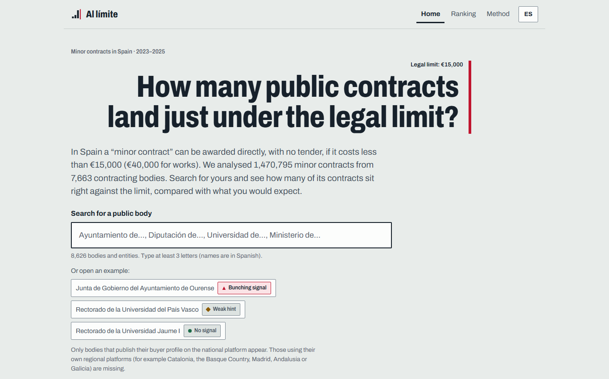
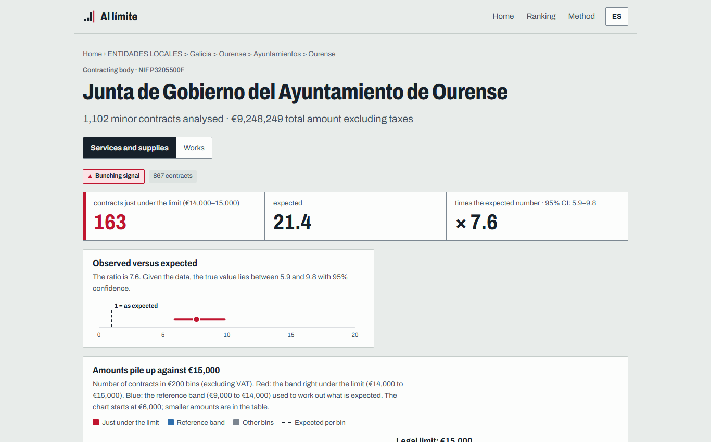

# Al límite

**A watchdog for Spanish minor public contracts that land just under the legal limit.**
Search any public body, see its "wall" of contracts right below €15,000, how many you would expect instead, how
sure we can be, the contracts themselves (linked to the official platform) and a plain-language explanation
written with a small open AI model that runs on a laptop and is checked sentence by sentence.

*Resumen en español:* buscador de organismos públicos españoles que muestra cuántos de sus contratos menores se
quedan justo por debajo del límite legal (15.000 € en servicios y suministros, 40.000 € en obras), cuántos cabría
esperar, con qué incertidumbre, y una explicación en lenguaje claro generada con un modelo abierto en local y
verificada automáticamente. Es un indicador estadístico, no una acusación.

**[Live demo](https://al-limite-two.vercel.app)** (opens in English or Spanish to match your browser; nothing to
install) · **[2½-minute video](https://youtu.be/kv5HzLWF5oY)** ·
**[Devpost page](https://devpost.com/software/al-limite-who-keeps-landing-just-under-the-legal-limit)**

[](https://al-limite-two.vercel.app)
[](https://al-limite-two.vercel.app/#/u/30985210142281)

Built from scratch on 15–16 November 2026 as a solo student hackathon project. It is one project, entered in
SLAY HACKS, Code for Change, LaunchPad Hacks, AI OpenBuild, Silicon Valley Buildathon and GenHacks (all on
Devpost; the build dates fall inside the submission period of each). See
[How and when this was built](#how-and-when-this-was-built).

## The problem

In Spain a public body can award a *contrato menor* (minor contract) directly, with no tender, if its estimated
value is below €15,000 for services and supplies or €40,000 for works, VAT excluded (Ley 9/2017, art. 118).
Splitting a contract to stay under the limit is forbidden (art. 99.2), but nobody watches the distribution of
amounts: Spain's own procurement supervisor has said it lacks aggregated data on minor contracts.

When amounts pile up just under a threshold ("bunching"), the threshold is shaping how prices are set or how
contracts are defined. It is a known red flag used by auditors and economists. **It is not proof of wrongdoing.**
A citizen, a local journalist or a councillor has no easy way to see whether it happens in their town.

## What it does

- **Search** 7,663 contracting bodies and 963 entities (town councils, ministries, universities, public companies).
- **The wall**: a histogram of the body's contract amounts with the legal limit, the band right under it and
  the reference band used to work out what would be expected.
- **Observed vs expected** with an exact 95% confidence interval, a small-sample warning and a four-level label
  (signal / weak hint / no signal / sample too small).
- **The contracts** just under the limit, each linked to its official publication, repeat awardees
  (pseudonymised) and the month-by-month pattern (is it a December effect?).
- **A plain-language explanation** in Spanish and English: what the data shows, what it cannot show, what to check.
- **A ranking** of bodies where the signal is strongest, sorted by the cautious end of the interval.
- **A method page** with every decision, check and limitation.

Spanish UI with an English toggle. Static site, no backend, no tracking, works on a phone.

## Headline numbers (2023–2025)

| | Services and supplies | Works |
|---|---|---|
| Minor contracts analysed | 1,374,964 | 95,831 |
| Just under the limit | 68,251 (€14,000–15,000] | 13,484 (€37,500–40,000] |
| Expected from the reference band | 19,009 | 3,171 |
| Observed / expected | **3.59** (95% CI 3.56–3.63) | **4.25** (95% CI 4.15–4.35) |
| Bodies with a bunching signal | 684 of 1,243 assessable | 121 of 174 assessable |

The ratio is stable across the three years (3.58, 3.58, 3.61) and across the twelve months (3.4 to 3.8), so it
is not a year-end effect. Moving a fake "limit" in €500 steps from €7,000 upwards gives ratios below 1
(0.3 to 0.9) at every position up to €13,500, round numbers like €10,000 and €12,000 included; the ratio only
takes off when the band reaches the real limit. So it is not a taste for round numbers either.
All figures are in [`resultados/cifras.json`](resultados/cifras.json) and are regenerated by one command.

## How the AI is used, and its limits

No AI computes any number. A language model is used for one job: turning each flagged body's statistics into an
explanation a neighbour can read.

- **Open model, run locally.** Qwen3-4B (Apache 2.0) through llama.cpp on a laptop's integrated GPU. No paid API,
  no account, no data leaves the machine. Explanations are precomputed, so the site needs no model at runtime.
- **The model never rewrites a figure.** The code writes each fact as an exact sentence. The model receives the
  list, *chooses* which facts matter most for that body, and *writes in its own words* the caveats and the
  concrete things to check. Its output is constrained to a JSON schema by grammar-based decoding.
- **Every text is verified** (`allimite/explain.py::verificar`): each sentence containing digits must match a fact
  (same numbers, near-identical wording); the three core facts must be present; no digits in the model's own
  sections; citations must point to real contracts; no accusatory vocabulary; the caveat must be there.
  Three failed drafts → a fixed template, labelled as such on the page. Everything is verified again when the
  site is built.
- **No names.** The model never sees awardee names; the site shows awardees as letters and links to the official
  record.
- **What we learned.** We first let the model write the data paragraph. A 4B model copied the numbers right and
  still got the meaning wrong ("34.2% of contracts…" for a ratio of 34.2; the wrong band). A number-matching
  check did not catch that. So we moved the figures out of the model's hands. The rejected drafts are kept in
  `resultados/explicaciones.json`.
- **Limits.** The verifier checks figures, structure and tone, not whether each suggestion is the most useful
  one. The texts are labelled as AI-generated and always sit next to the data they describe.

## What was tested, what failed and what changed

All counts below come from `resultados/cifras.json` and `resultados/explicaciones.json` in this repository.

- **First design, dropped after testing.** The model wrote the data paragraph and a checker confirmed that every
  number in it was one of the computed ones. Reading the outputs showed texts that passed the checker and were
  still wrong (a ratio of 34.2 presented as "34.2% of contracts", the wrong price band). The fix was to change
  the design, so the model never restates a figure.
- **What the verifier caught in the final run.** It rejected 1,208 drafts (833 in English, 375 in Spanish):
  1,077 put figures in the model's own sections, 99 lacked the caveat, 55 cited a contract that does not exist,
  36 used accusatory wording or spoke of contract splitting outside the caveat, and 11 were too long (a draft can
  fail for more than one reason). 314 of the 893 flagged pages passed first time in both languages.
- **Where the model still fails.** After three failed drafts the page gets a fixed template, labelled as such:
  166 of the 1,786 texts (37 in Spanish, 129 in English). The 4B model is clearly weaker in English.
- **Statistics.** 52 automated tests, including simulations of the interval's coverage and of the false-positive
  rate; an independent recount in plain SQL (`python -m allimite.check`) that must match the published figures;
  the fake-limit sweep and the by-year and by-month checks described above.
- **Website.** Checked in a headless browser (Playwright) in Spanish and English, at desktop width and at 390 px,
  light and dark: no console errors and no horizontal scrolling. That review led to round axis steps, the town
  council ranked above the provincial body when you search a town's name, and the one-click examples on the home
  page for visitors who do not know Spanish body names.
- **Not done.** No one outside the project has tested it yet, and no audit institution has reviewed the list.

## Method in short

For services and supplies: *near* = (€14,000, €15,000], *reference* = (€9,000, €14,000], five times as wide.
Expected = reference count / 5. Ratio = near / expected. For works: (€37,500, €40,000] and (€25,000, €37,500].
The reference is conservative, because dearer contracts are normally rarer.

Uncertainty: counts are treated as Poisson; conditional on the window total the near count is binomial, which
gives an exact (Clopper-Pearson) interval for the ratio and a one-sided test of ratio = 1. P-values are
corrected across bodies with Benjamini-Hochberg. A body gets a **signal** only with ≥30 contracts in the window,
≥10 near the limit, q < 0.01 and a lower interval bound ≥ 2.

Full method, checks and limitations: `site/metodo.en.html` (the Method page of the site).

Things this cannot tell you: whether any contract was actually split (that takes reading the files); the legal
limit refers to estimated value while we use award amounts; research bodies have a higher limit in some cases;
the data are entered by each body and contain errors; only bodies hosted on the national platform are covered
(regional platforms such as Catalonia's or the Basque Country's are not in this dataset).

## Reproduce everything

```bash
pip install -r requirements.txt
python -m allimite todo      # download (1.1 GB) → SQLite → analysis → explanations → site data
python -m pytest             # 61 tests: parser, bin edges, interval coverage, false-positive rate, verifier, essay figures and links
python -m allimite.check     # recounts the national figures with independent SQL and compares
python -m allimite servir    # http://127.0.0.1:8000
```

**Visual essay.** `site/story.html` (“The €14,999 wall”) tells the national story in English with hand-written SVG
charts. It is generated by `python -m allimite historia` from `allimite/historia.html`, a template with no numbers in
it: every figure is read from `resultados/` and the three example pages, and `tests/test_story.py` fails if the page
drifts from the results or if the template gains a hand-typed number. `analizar`, `explicar` and `todo` rebuild it.

`todo` runs `descargar`, `leer`, `analizar` and `explicar` in order; each can be run on its own.
Data live outside the repo (set `ALLIMITE_DATA` to choose where; default in `allimite/config.py`).
The site only needs `site/`, which already contains the precomputed data, so the last command is enough to see it.

To regenerate the explanations you need a local llama.cpp server (any recent release) with the model:

```bash
llama-server -m Qwen3-4B-Q4_K_M.gguf --host 127.0.0.1 --port 8089 -c 4096 -ngl 99
python -m allimite explicar
```

Without a server, `todo` keeps the saved explanations whose facts have not changed and drops the rest.

## Repository

```
allimite/   fetch.py (polite download + manifest)   parse.py (ATOM/CODICE → SQLite)
            stats.py (indicator, interval, FDR)     analyze.py (everything the site shows)
            explain.py (facts, model call, verifier) check.py (independent recount)
            cpv.py, config.py, __main__.py
tests/      test_stats.py, test_explain.py, test_parse.py, test_site.py
site/       index.html, app.js, style.css, metodo.*.html, data/ (precomputed JSON)
resultados/ cifras.json, ranking_*.csv, explicaciones.json (texts and rejected drafts)
```

No JavaScript dependencies and no build step. Python: numpy, pandas, scipy, lxml, requests.

## Data, licence and attribution

- **Data:** Plataforma de Contratación del Sector Público (Dirección General del Patrimonio del Estado, Ministerio
  de Hacienda), open dataset "Contratos menores publicados en los perfiles del contratante ubicados en la
  Plataforma", yearly files 2023–2026, downloaded on 15 November 2026. Reuse under Spain's Ley 37/2007; the
  platform's legal notice authorises reproduction of its contents provided the source is cited. The URL, size and
  SHA-256 of each file are in `resultados/cifras.json` (`fuente`). This project is not affiliated with or endorsed
  by the Ministry.
- **Code:** MIT, © 2026 Antonio González Fernández.
- **Model:** Qwen3-4B, Apache 2.0 (Alibaba Cloud). **Runtime:** llama.cpp, MIT.

## How and when this was built

- **Built from scratch on 15–16 November 2026** (see the git history; first commit 15 Nov 2026, 17:28 CET) for
  SLAY HACKS on Devpost, and entered as the same project in Code for Change, LaunchPad Hacks, AI OpenBuild,
  Silicon Valley Buildathon and GenHacks. All code in this repository was written from 15 November 2026 on;
  later commits are small fixes.
- **Prior work it builds on (ideas, not code):** the question comes from my earlier data-journalism pieces for
  the Open Data Bizkaia data-journalism challenge (November 2026), one of which looked at minor contracts in
  Bizkaia. That pipeline was not reused: this is a new national analysis, written from scratch, with the
  confidence intervals, the fake-threshold check and the verified AI explanations added here.
- **AI assistance:** the code was written with the help of an AI coding assistant (Claude, Anthropic); every
  figure on the site is computed by the code and re-checked by an independent recount (`check.py`).
- The six entries share one Devpost page, which lists all six events.

## Responsible use

The ranking is a list of where to look, not a list of offenders. A high ratio can come from market prices, fixed
budgets or separate needs. Please do not present these figures as evidence that a body, a person or a company
broke the law.
